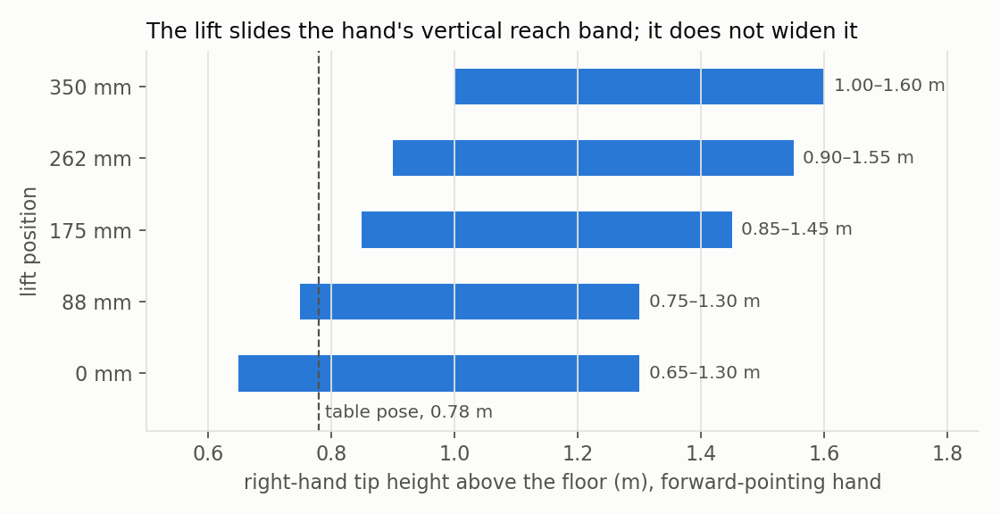
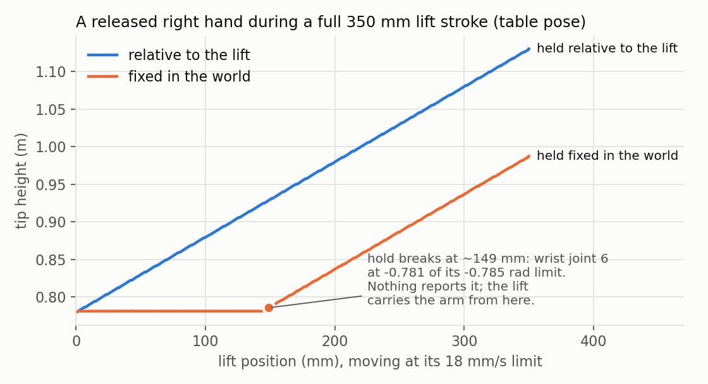

# Teleoperating OpenArm on a lift: what the lift does to a clutch

A simulation study on [openamr-upperbody-sw](https://github.com/openAMRobot/openamr-upperbody-sw) at `17cf693`
(platform-sw `131e500`, openarm_description `14ff67b`, openarm_ros2 `4e837e1`), run on its own MoveIt
configuration and mock ros2_control stack.

**Simulation only.** Mock hardware reflects commands back as state, so there are no dynamics, no tracking error
and no robot. Nothing here is hardware, safety or acceptance evidence. The upstream repository was not modified.

## In short

- **The lift slides the hand's vertical reach band; it doesn't widen it.** With a forward-pointing hand, the
  right tip reaches 0.65–1.30 m at the bottom of the stroke and 1.00–1.60 m at the top.
- **Holding a released hand fixed in the world fails partway through the stroke.** From a table-height pose
  the hold broke at about 149 mm of the 350 mm stroke, when wrist joint 6 reached its limit. Nothing reported
  it: IK failed, the arm stayed at its last solution, and the lift carried the hand 207 mm above its held
  position.
- **A clutch that anchors in the arm-mount frame (`lift_carriage_link`) works across a full stroke.** After
  release, a full lift stroke and a re-grip, the hand's 100 mm move gave 102.5 mm at the tip, with 0 IK
  failures and no jump.
- **A clutch that continues from its held target goes dead after a broken hold.** The tip didn't move for a
  50 mm or 100 mm hand move, and IK failed on every tick. Re-anchoring to the measured tip restored motion in
  the feasible direction only.

## 1. Reproducing the repository

On a fresh ROS 2 Jazzy (Ubuntu 24.04 under WSL2), following the README exactly:

| Step | Result |
|---|---|
| `rosdep install` for the five packages | all resolved |
| `colcon build` (8 packages) | passed, 48 s |
| `verify_a6.sh` | **no FAIL**: 25 PASS, 3 WARN (E01, W02, V01, all as documented), 0 SKIP |
| `moveit.launch.py sim:=mock` | all six controllers active in about 8 s |

No README step needed a workaround. One note for teleoperation: W02 means KDL turns the planar base into a
fixed joint, so whole-body IK (base plus arm) can't use the current kinematics configuration.

## 2. Reach and the lift

Inverse kinematics through the running `move_group` (`/compute_ik`, the repository's `kinematics.yaml`, KDL),
right arm, on a 5 cm grid in front of the right shoulder, at five lift positions, for two hand orientations
taken from the model: the tip at home, and the tip with the elbow bent 90° (forward-pointing).



A target held fixed in the world while the lift rises from 0 stays reachable to:

| Hand orientation | ≥ 88 mm | ≥ 175 mm | ≥ 262 mm | full 350 mm |
|---|---:|---:|---:|---:|
| Forward-pointing (186–188 start points) | 74–76% | 48% | 29% | 13% |
| Home (95–99 start points) | 49–52% | 29% | 14% | 5–6% |

Ranges cover two runs. KDL restarts randomly, so the point counts differ by a few between runs.

**The solver is not the limit.** Retrying the 150–165 grid points next to the reach boundary with six random
seeds and a 0.2 s timeout found 9–11 more solutions. The percentages are slight underestimates. The configured
5 ms timeout solved 93–94% of reachable points from a home seed.

## 3. A released hand while the lift moves

The real `lift_controller` ran a full stroke at the URDF's 18 mm/s limit (19.4 s), with the right hand
released. The hand was held one of two ways:

- **relative to the lift:** the arm was not commanded, so the lift carried it;
- **fixed in the world:** IK at the current lift height was streamed to `right_arm_controller` at 20 Hz.



| Start pose | Hold | Tip moved in the world | Hold broke at | IK failures | Arm motion, unattended |
|---|---|---:|---:|---:|---:|
| Table (tip 0.78 m) | relative to the lift | 350 mm | n/a | n/a | 0 rad |
| Table (tip 0.78 m) | fixed in the world | 207 mm | ~149 mm | 239 of 399 ticks | 2.14 rad |
| Raised (tip 0.92 m) | relative to the lift | 350 mm | n/a | n/a | 0 rad |
| Raised (tip 0.92 m) | fixed in the world | 176 mm | ~180 mm | 204 of 399 ticks | 1.64 rad |

A second run gave the same values within 1 mm (the table hold broke at 148 mm).

In both world-fixed runs, wrist joint 6 was at -0.781 or -0.782 rad (limit -0.785) when the hold broke:
keeping the hand's orientation fixed as the shoulder rises used up the wrist's range. Peak joint speeds stayed
at or below 6% of their limits, so the lift's speed was not the problem.

## 4. A clutch on the lift

A scripted operator hand drove the right arm through a clutch:

1. Engaged, the hand moved 50 mm forward.
2. Released, the lift ran its full stroke.
3. Re-gripped, the hand moved 100 mm down, or 50 mm up, at 50 or 25 mm/s.

Three anchoring rules were compared:

| Rule | While released | Re-grip continues from |
|---|---|---|
| Arm mount | target fixed in `lift_carriage_link`; arm not commanded | the held target |
| World, held target | target fixed in `base_footprint`; IK streamed | the held target |
| World, measured tip | as above | the measured tip pose (TF) |

| Rule | Held target vs tip at re-grip | Hand down 100 mm: tip | Hand up 50 mm: tip | IK failures, engaged |
|---|---:|---:|---:|---:|
| Arm mount | 0 mm | **-102.5 mm** | **+51.2 mm** | 0 / 0 |
| World, held target | 230 mm | 0 mm | 0 mm | 62 / 62 (every tick) |
| World, measured tip | 230 mm | 0 mm | **+51.3 mm** | 62 / 0 |

A second run gave identical values. The 1.5–3 mm largest per-tick step at re-grip is the hand's own motion at
20 Hz, not a jump.

## What this suggests

These are suggestions from simulation, for discussion:

1. **Anchor teleoperation targets in the arm-mount frame by default.** A lift move then carries the hands, which
   is easy to predict and never leaves the workspace. OpenArm's own IK node (`dora-openarm-kinematics`) takes
   targets in an origin frame of the OpenArm model, which has no lift, so mounted here it gets this behaviour
   without changes.
2. **Treat the lift as a repositioning move, not a tracking joint.** At 18 mm/s, raising the hands 10 cm takes
   5.6 s. This matches the platform's own rule: per the SRDF, register LIFT allows lift motion only in the
   stowed or carry pose with the base stopped, enforced by the lift firmware (CTL-017). The results above show
   what happens without that rule, and a clutch anchored in the arm-mount frame is what makes a re-grip after a
   between-task lift move continuous.
3. **Consider the same rule in simulation.** The SRDF notes that the A7 scenario respects it by design, not by an
   interlock, and these runs confirm `lift_controller` accepts a goal with an arm engaged. A sim-side guard that
   refuses lift goals outside the stowed and carry poses would make simulated teleoperation behave like the
   hardware.
4. **If a world-fixed hold is ever wanted while the lift moves,** check reachability along the stroke first,
   stop the lift before the hold breaks, and report it. Don't let an IK failure quietly turn the hold into a
   carried arm.
5. **After anything moves under a held target, re-anchor to the measured pose,** not the held one.

## Limits

- Mock hardware only: no dynamics, contact, latency or tracking error. Gazebo (A7) was not run.
- Right arm only, one hand-orientation family per sweep, base stationary (as AD-30 specifies).
- Two clean runs of everything (`results/` and `results/run2/`). A third run, made while an earlier stack was
  still running on the same ROS domain, gave corrupted live results and was discarded. `run_all.sh` now refuses
  to start in that state, and each live run checks that the arm reached its start pose.
- Reach is a solver-backed lower bound on a 5 cm grid, with orientation fixed. Position-only holds would last longer.
- No operator, headset or XR input: the hand is scripted.
- All timing is from one WSL2 machine.

## Reproduce

Build the workspace as the repository's README says, then:

```bash
bash scripts/run_all.sh results
```

That starts `moveit.launch.py sim:=mock`, runs every experiment (about 14 minutes), and redraws the figures. The
raw results are in `results/` (JSON, per-tick samples included). The figures show run 1.

Scripts and text: MIT. Written with AI assistance (Claude Code). Every number above comes from the files in `results/`.
